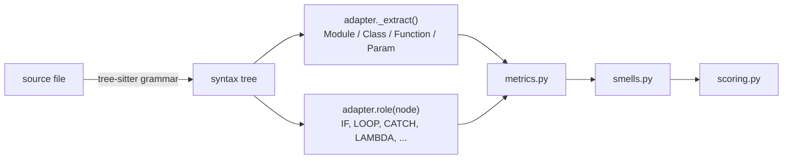

<a href="https://claude.ai"></a>
[](https://github.com/epatel/ai-health/actions/workflows/ci.yml)

# aihealth

Code health estimates (1–10, CodeScene-style) for **Python**, **Dart/Flutter**,
**Swift/SwiftUI**, **Rust**, **TypeScript/TSX**, **JavaScript/JSX**, **C**, **C++**,
**Objective-C** / **Objective-C++**, **shell scripts** (bash, zsh), **Makefiles** and **CMake**,
built as feedback for AI coding agents.

- **delta**: did this change make the code healthier or worse? Verdict, score before → after,
  new/worsened smells with `path:line` and fix hints. Exit code 1 when health degraded.
- **scan**: overview of a codebase. Project score, worst files, top refactoring targets.
- **MCP server**: the same, as tools an agent calls itself.

Scores come from 13 explainable code smells: Brain Method, Large/Complex Method, Cognitive
Complexity, Deep Nesting, Bumpy Road, Excess Arguments, Complex Conditional, Deep Widget
Tree (Flutter, SwiftUI, JSX), Large File, Low Cohesion, Primitive Obsession and Code Duplication. Bands:
healthy ≥ 9, warning 4–9, alert < 4.

## Install

Needs Python 3.11+ and git 2.24+. The recommended way is into the venv of the project you
want to check, so nothing is installed globally:

```bash
cd your-project
python3 -m venv .venv                      # skip if the project already has one
.venv/bin/pip install "git+https://github.com/epatel/ai-health"
.venv/bin/aihealth scan .
```

Or install it globally, or from a clone to work on aihealth itself:

```bash
uv tool install "git+https://github.com/epatel/ai-health"   # or: pipx install "git+..."
python3 -m venv .venv && .venv/bin/pip install -e .         # from a clone (or: make setup)
```

The examples below write `aihealth`: that is `.venv/bin/aihealth` with a venv install.

**Full setup** (MCP server, hooks; in a project's venv, for a project, or for you):
[AGENT-INSTALL.md](AGENT-INSTALL.md) lists the exact commands and file changes, plus a short
prompt that has your agent do the same steps.

## CLI

```bash
aihealth delta                      # working tree (incl. untracked) vs HEAD
aihealth delta --staged             # staged changes only
aihealth delta --base main --head HEAD lib/   # a commit range, limited to lib/
aihealth delta --format markdown    # agent-oriented output (also: text, json)

aihealth scan path/to/repo --format markdown --max-findings 20
aihealth scan . --fail-under 7      # CI gate on the project score
aihealth scan src/app.py            # one file (also: x.dart, main.rs, app.tsx, app.js, x.c, x.cpp, x.m, x.sh, bin/deploy, Makefile, CMakeLists.txt)
```

## History

```bash
aihealth scan . --save     # store in .aihealth/health.db (self-gitignored)
aihealth history           # score per saved scan, Δ, config, aihealth and parser changes
```

## Dashboard

```bash
aihealth serve --repo path/to/repo     # http://127.0.0.1:8765
```

It shows an overview (score, trend, where the penalty comes from, worst files), a treemap
(area = lines of code, colour = health), and per-file findings and function metrics. "Scan now"
runs and saves a scan. Charts load ECharts from a CDN (pinned, with an integrity hash).

The dashboard has no authentication and is meant for your own machine (the default
`--host 127.0.0.1`). It accepts only requests addressed to that host (so another website
can't read it through DNS rebinding), refuses "Scan now" posts from other sites, and can't
be framed. `--host 0.0.0.0` makes it reachable from the network; `serve` then prints a
warning.

## MCP server (Claude Code and other agents)

Register it for a project (run inside that project; the server analyses its working directory).
With aihealth in the project's venv, add to `.mcp.json` in the repo root:

```json
{ "mcpServers": { "aihealth": { "command": ".venv/bin/aihealth", "args": ["mcp"] } } }
```

With a global install: `claude mcp add aihealth -- "$(command -v aihealth)" mcp`.

Tools:

| Tool | Use |
|---|---|
| `review_changes` | Delta of uncommitted (or `staged`) changes vs `base`. Call after editing |
| `preview_change` | Score proposed `content` for a file against the current file without writing it |
| `score_file` | All smells in one file |
| `scan_project` | Project overview |
| `explain_smell` | What a smell measures and how to fix it |

All tools return markdown by default (`output: "json"` for machine use).

## Automatic feedback in Claude Code (hooks)

Instead of relying on the agent to remember, let Claude Code run aihealth itself. Add to the
project's `.claude/settings.json` (this form uses the project's venv and does nothing when
aihealth isn't installed there; for a global install see [AGENT-INSTALL.md](AGENT-INSTALL.md#hooks)):

```json
{
  "hooks": {
    "PostToolUse": [
      { "matcher": "Edit|Write",
        "hooks": [{ "type": "command", "command": "a=\"$CLAUDE_PROJECT_DIR/.venv/bin/aihealth\"; [ -x \"$a\" ] && \"$a\" hook post-edit || true" }] }
    ],
    "Stop": [
      { "hooks": [{ "type": "command", "command": "a=\"$CLAUDE_PROJECT_DIR/.venv/bin/aihealth\"; [ -x \"$a\" ] && \"$a\" hook stop || true" }] }
    ]
  }
}
```

- **post-edit**: after each edit of a supported file, checks that file against HEAD. Silent
  unless it got worse; then Claude gets the regressions with fix hints next to the edit result.
- **stop**: when Claude is about to finish, checks all uncommitted changes. If health degraded,
  Claude gets one more turn to fix them (or to say why they are intended). It never fires twice
  in a row, so it cannot loop.
- Both fail open: outside a git repo, for other languages, or on any error they do nothing.

## Swift

`*.swift` files are scored with the generic smells; nothing is Swift-only.

- **Units**: functions, methods, `init`/`deinit`, operators, subscripts, computed-property
  getters/setters and `willSet`/`didSet` observers. Local functions and local types are
  scored on their own; closures stay part of their function. `#Preview { }` blocks and
  Quick-style `describe`/`context`/`it` closures are units too (configurable).
- **Types**: struct, class, enum, actor and extension are all classes for Low Cohesion
  (stored, non-`static` properties are the state).
- **Parameters** with a call-site label count half for Excess Arguments; `_ x` counts
  fully.
- **SwiftUI**: nesting of view calls (`VStack { HStack { Text(...) } }`) is the Deep
  Widget Tree depth. View-builder closures don't add cognitive nesting (they are layout,
  not control flow); `Task { }` and `.map { }` closures do. `body` uses the normal Large Method limit (measured below).
- **Skipped**: `.build/`, `Pods/`, `DerivedData/`, `*.docc/` (tutorial step files),
  `*.generated.swift` and SwiftGen/Sourcery output.
- Very new or stdlib-internal syntax (`@_lifetime`, `__owned`) and `f(())` are not in
  the grammar yet: such files report "syntax errors", and the rest of the file is still
  scored.

## Rust

`*.rs` files are scored with the generic smells.

- **Units**: functions, methods in `impl` and `trait` blocks (default bodies), and items
  nested in a function. Closures stay part of their function. Modules prefix qualnames
  (`net::http::post` is `net.http.post`). `self` isn't counted as a parameter.
- **`impl` and `trait` blocks** are classes. Low Cohesion is measured per `impl` block
  through `self.x`; traits (no state) and builder setters (`fn x(mut self, ..) -> Self`)
  aren't judged.
- **Branching**: `else if`, `match` arms (`_` is the default), `let … else` (counts once,
  like a guard), let-chains (`if let Some(x) = y && x > 0`), labeled `break 'outer`. The
  `?` operator adds nothing.
- **Unit tests** in `#[cfg(test)] mod tests` are left out of the score by default (no
  units, lines or duplication), so a file is judged on its production code, as in
  languages with separate test files. Integration tests in `tests/` are scored. Set
  `score_test_modules = true` under `[rust]` to include them.
- **Skipped**: `target/debug/`, `target/release/` and files marked `@generated`.
- Code inside macro invocations (`quote! { }`, `tokio::select! { }`) is opaque to the
  parser and not scored.

## TypeScript

`*.ts`, `*.mts`, `*.cts` and `*.tsx` files are scored with the generic smells.

- **Units**: function declarations, class methods (incl. `constructor`, getters and
  setters), functions assigned to a name (`const f = () => {}`, class fields like
  `onClick = () => {}`, methods of a named object literal `const api = { get() {} }`),
  `export default` functions, and closures passed to `describe` / `it` / `test` /
  `beforeEach` / … (configurable). Inline callbacks (`xs.map((x) => …)`) stay part of
  their function. Nested named functions are scored on their own.
- **Branching**: `else if`, `switch` (`default` is not a path), `catch` (`finally` adds
  nothing), ternaries, labeled `break`/`continue`, and `&&` / `||`, including JSX
  conditional rendering (`{open && <List />}`). `??` and `?.` add nothing.
- **JSX** (`.tsx`): element nesting is the Deep Widget Tree depth.
- **Skipped**: `*.d.ts` declaration files and `node_modules/`.

## JavaScript

`*.js`, `*.mjs`, `*.cjs` and `*.jsx` files are scored like TypeScript (same unit rules,
same branching, JSX depth in any file), with one addition: functions **assigned** to a
name are units too, because CommonJS and pre-class code define them that way:
`module.exports = { format() {} }` (`module.exports.format`), `app.handle = function handle()
{}` (`app.handle`), `Router.prototype.route = function () {}` (`Router.route`).
Parameters are untyped, so Primitive Obsession doesn't apply. `*.min.js` and `*.bundle.js`
are skipped. Flow-annotated JavaScript isn't supported (it parses with errors).

## C, C++, Objective-C and Objective-C++

`*.c`, `*.cpp`/`*.cc`/`*.cxx`, `*.hpp`/`*.hh`/`*.hxx`, `*.m`, `*.mm` and `*.h` files are
scored with the generic smells. One adapter covers the four languages, because a `.h` header
can be any of them: it is parsed as Objective-C if it has `@interface`/`@implementation` or
`#import`, as C++ if it has `namespace`, templates, class bodies or `::`, as Objective-C++
if it has both, and as C otherwise.

No grammar parses Objective-C++, so `.mm` files are read with the Objective-C grammar
after `a::b` is rewritten to one identifier (names still read `A.f` for `A::f`). C++
syntax the grammar doesn't know (lambdas, templates, braced initializer lists) leaves
parse errors; methods inside them are still found, but about 9 % of `.mm` code lines
end up outside any scored function.

- **Units**: every function definition (also inside `#if` blocks, `extern "C"`,
  namespaces, class bodies and code the grammar failed to parse), C++ methods defined in the class (`Cart.add`) or out of
  line (`int Cart::discount()` → `Cart.discount`), constructors, destructors and operators,
  and Objective-C methods named by selector (`Greeter.greet:times:`). Namespaces prefix
  names. Lambdas and blocks stay part of their function.
- **Branching**: `else if`, `switch` (`default` is not a path), loops including range-for,
  `catch` / `@catch`, ternaries, `&&` / `||`, and `goto` (+1, as SonarSource specifies).
  `#if` / `#ifdef` add nothing: they are compile-time.
- **Parameters**: Objective-C selector parameters are labelled, so they count half for
  Excess Arguments. For Primitive Obsession, `int`, `char *`, `size_t`, `std::string`,
  `NSString *` and friends are primitive; `std::vector<Order>` is judged by `Order`.
- **Cohesion**: C++ classes are judged only when all their methods are defined in the
  class body (out-of-line methods usually live in another file). Objective-C uses instance
  variables, `self.x` and `[self method]`.
- **Macros**: the grammars see the source without its `#if`/`#else`/`#endif` lines (both
  branches as one), with `typedef NS_ENUM(...)` read as an enum and lines holding only an
  ALL_CAPS macro (`Q_OBJECT`, `NS_ASSUME_NONNULL_BEGIN`) blanked. Macros the grammar
  still can't expand leave local parse errors, so parse errors aren't reported.
- **Skipped**: protobuf `*.pb.cc`/`*.pb.h`, Qt `moc_*.cpp`/`qrc_*.cpp` and anything
  marked "All changes made in this file will be lost" (uic), flex/bison output.
  Vendored folders (`third_party/`, `vendor/`) are scored: add them under `[scan] exclude`.

## Shell scripts

`*.sh` and `*.bash` files, and **extensionless files whose first line is a `sh`, `bash`,
`dash` or `ksh` shebang** (`bin/deploy`, `libexec/rbenv-init`), are scored with the generic
smells. So is **zsh**: `*.zsh`, `*.zsh-theme`, zsh shebangs and completion/autoload
functions (`_docker`, starting with `#compdef` or `#autoload`).

- **Units**: functions (`f() { ... }`, `function f { ... }`), wherever they're defined, named
  plainly because shell functions are global; and top-level `if` / `for` / `while` /
  `until` / `case` blocks (zsh also `repeat`, `select`, `for x (a b)`), named by their
  first line. zsh anonymous functions (`() { ... }`) are units named `(anonymous)`.
  Plain top-level commands aren't units, as in CMake.
- **Branching**: `elif`, `case` arms (`*)` is not a path), loops, `&&` / `||` in command
  lists and in `[[ ]]`, arithmetic ternaries, and `break 2` / `continue 2` (+1, like a
  labeled jump). Guards like `cmd || die` count; they are 3 % of the cognitive points in
  the calibration corpora.
- **Skipped**: scripts generated by autoconf (`configure`), `config.status` and libtool.
  Parse errors aren't reported (the grammar has gaps, such as `$` inside backticks).
- **zsh parsing**: the zsh grammar is young. Each zsh file is parsed with both the zsh
  and the bash grammar, and the tree that loses fewer lines wins; the zsh grammar runs
  in a forked child with a time limit first, because some input sends it into
  an endless loop. About 3 % of zsh lines are still unscored (parse errors), and short
  forms (`if [[ x ]] { ... }`, `while x { ... }`) aren't understood.

## Makefiles

`Makefile`, `makefile`, `GNUmakefile` and `*.mk` files are scored with the same smells,
mapped onto make:

- **Rules with a recipe** are the "functions". The recipe is parsed as shell (bash), so long
  recipes (Large Method), nested `if`/`for` shell logic (Deep Nesting, Cognitive Complexity)
  and `&&`/`||` chains in conditions are measured on the real Makefile lines.
- **`define` blocks** are scored as canned shell recipes, or as make templates when they
  contain make syntax.
- **Top-level `ifeq`/`ifdef` blocks**, and variables built with `$(if)`, `$(or)`, `$(and)`
  or `$(foreach)`, are scored for their make-level branching.
- **Copied recipes** show up as Code Duplication. Fix hints suggest make remedies:
  pattern rules, `define` + `$(call)`, moving shell into a script file.
- **Missing .PHONY** (Makefile-only smell): targets that never create a file of their
  name (`clean`, `test`, `all`) but aren't listed in `.PHONY`. If a file or directory with
  that name ever exists, `make test` silently does nothing. The check is conservative:
  targets writing `$@` or mentioning their own name, names with `.`/`/`/`%`/`$`, empty
  `FORCE:` rules and special targets are skipped, and `.PHONY: $(VARS)` is expanded from
  the file's own assignments (nothing is reported if it can't be expanded).

## CMake

`CMakeLists.txt` and `*.cmake` files are scored like Makefiles:

- **Units**: `function()` and `macro()` definitions (also inside top-level `if` blocks),
  and top-level `if` / `foreach` / `while` blocks, named by their header
  (`if(WIN32 AND NOT MINGW)`). Plain top-level commands (`set`, `add_library`) aren't
  units, like Make assignments.
- **Branching**: `if` / `elseif` / `else`, loops, and `AND` / `OR` in conditions.
  Commands are case-insensitive (`IF()` works too).
- **Hints** suggest CMake remedies: a `function()` for repeated commands, `include()`d
  files or `add_subdirectory()` for long blocks, generator expressions for platform chains.
- **Skipped**: `CMakeFiles/`, `cmake-build-*/`, `_deps/` (FetchContent), files marked
  "Generated by CMake", and `configure_file()` templates (`*.h.cmake`).

Generated files (automake, CMake, qmake, Qt, bison output, and in every language anything marked
"DO NOT EDIT" or "@generated") are skipped, and so are files over 1 MB (`[scan] max_file_kb` in
`.aihealth.toml`), in scan, delta, the hooks and the MCP tools: parsing one can take seconds.
Delta reports list them as "Not scored" with the reason, and the MCP tools return an error.
Scoring one file by hand (`aihealth scan big.py`) has no limit.

## Configuration

Optional `.aihealth.toml` at the repository root (all keys in `src/aihealth/config.py`):

```toml
[thresholds]
large_method = 100

[weights]
primitive_obsession = 0          # 0 disables a smell

[scan]
exclude = ["legacy/*"]           # added to defaults (*.g.dart, *.freezed.dart, build/, ...)

[dart]
test_closure_calls = ["group", "test", "testWidgets", "patrolTest"]

[swift]
test_closure_calls = ["describe", "context", "it"]   # default: Quick's full set

[rust]
score_test_modules = true        # include `#[cfg(test)]` modules (default: false)

[typescript]                     # .ts and .tsx
test_closure_calls = ["describe", "it", "test"]

[javascript]                     # .js, .mjs, .cjs and .jsx
test_closure_calls = ["describe", "it", "test"]
```

Turn smells off for one file where they are imposed by an interface (e.g. CLI/JSON/MCP
boundaries) with a comment (strings and docstrings don't count):

```python
# aihealth: disable=primitive_obsession, excess_arguments
```

## Adding a language

All metrics, smells and scoring are language-neutral. A language is **one adapter file**
that tells the engine what the syntax tree means, plus tests that pin that meaning. Python
(`src/aihealth/lang/python.py`), Dart (`lang/dart.py`), Swift (`lang/swift.py`), Rust
(`lang/rust.py`), TypeScript (`lang/typescript.py`), JavaScript (`lang/javascript.py`, a
subclass for a grammar that shares node names) and C/C++/Objective-C(++) (`lang/cfamily.py`,
one adapter that picks a grammar per file) are the reference adapters; `lang/shell.py` is
the smallest, and shows units for top-level blocks. Copy the one whose language is closer.

### How the pieces fit



The adapter answers two questions. **What are the functions, classes and parameters?**
That's `_extract`, which builds the model in `model.py`. **What does each node mean for
complexity?** That's the `roles` table plus a few hooks. Nothing else in the engine knows
about syntax.

### Steps

I'd do it in this order. Each step has a check before you move on.

1. **Spike the grammar first.** Grammars come from `tree-sitter-language-pack` (the name in
   `language` must match its grammar name). Write a fixture with *modern* syntax for the
   language, parse it, and dump the node types. Check that there are zero `ERROR` nodes,
   and note quirks: Dart, for example, puts a function body *next to* its signature
   instead of inside it. Add a test like `tests/test_parser_spike.py` that pins the node
   names you'll rely on, so a grammar upgrade fails loudly. Record the quirks in
   `cards/parser-choice.md`.

2. **Write the adapter** (`src/aihealth/lang/<name>.py`, subclass `LanguageAdapter`):

   | Part | What to provide |
   |---|---|
   | `language`, `extensions` | grammar name, file extensions |
   | `_extract(module)` | every scorable function as a `Function`: unique dotted `qualname`, `kind`, line span, `params`, and the **body node** (metrics walk only this). Classes, and their analogues (Go receiver types, Rust `impl` blocks, Swift extensions), become `Class`. Named nested functions become their own `Function` and are given the `STOP` role, so they aren't counted twice. |
   | `Param` | `named=True` for parameters that are named at the call site (Kotlin/Swift labels, Python keyword-only, Dart `{}`), which count half for Excess Arguments. `type_text` as written, or `None` if untyped. |
   | `roles` | node type → `Role`: `IF`, `LOOP`, `SWITCH`, `CASE` (non-default arms), `CATCH`, `TERNARY`, `LAMBDA` (closures), `STOP`, `COMPREHENSION`, `JUMP_LABEL`, `BOOL_EXPR` |
   | `role(node)` override | only where meaning depends on context: an else-if, a `default`/`_` arm, a catch body that is a sibling block, labeled jumps |
   | `else_if(node)` | only where the grammar wraps an else-if (Rust `else_clause > if_expression`): return the inner IF node |
   | `bool_token(node)` | `"and"`/`"or"` for `&&`/`\|\|`/`and`/`or` tokens. Count tokens, don't trust the tree shape (grammars disagree on precedence). |
   | `comment_types`, `block_types`, `bool_transparent` | for line counts, statement lists and condition detection |
   | `primitive_types`, `base_types()` | for Primitive Obsession; generics are judged by their type arguments (`List<Order>` is a domain type) |
   | `literal_types` | literal nodes that duplication detection normalises |
   | `member_refs(cls)` | which fields/methods each method touches (LCOM4 cohesion). It can return `{}` at first, which simply disables the smell. |
   | `widget_depth(body)` | optional UI-tree depth. It suits JSX, SwiftUI and Compose as well as Flutter. |
   | `grammars`, `_grammar_for()` | optional: further grammars and the per-file choice, when one extension can hold several languages (C-family `.h`). The choice becomes `module.language`. |
   | shebang routing | extensionless files are routed by content only for shell scripts (`is_shell_head` in `lang/shell_zsh.py`); callers pass the file's first bytes as `head` to `is_supported` / `adapter_for` |
   | `_prepare(source, language)` | optional: what the grammar parses, same length and line breaks (the C family blanks `#if` lines and lone macros the grammars trip over) |

3. **Register it**: add the class to `ADAPTERS` in `src/aihealth/lang/__init__.py`. Add
   generated-file patterns to `DEFAULT_EXCLUDES` in `config.py`. If the language needs
   options (like Dart's `test_closure_calls`), add a config section and map it in
   `Config.adapter_options`.

4. **Golden metric tests.** Port the SonarSource cognitive-complexity examples
   (`sumOfPrimes` = 7, `getWords` = 1, `a && b && c || d || e && f` = +3), as in
   `tests/test_metrics.py`. Then add cases for the language's own constructs: else-if,
   default arms, closures, labeled breaks, pattern matching, error handling.

5. **Coverage check on real code.** Run the adapter over a large, well-known codebase in the
   language. There should be no crashes, every function-body node should be extracted, and
   it should be reasonably fast (Dart reached 100 % of 60,461 bodies across the Flutter SDK).
   Fix what's missed. The misses are usually unusual declaration forms.

6. **Calibrate.** Add a few well-regarded libraries and a few big, complex codebases to
   `CORPORA` in `scripts/calibrate.py`, then run it. Good libraries should land mostly
   *healthy* and complex code around 5–7. If a language idiom trips a threshold everywhere
   (as Flutter `build()` methods did for Large Method), add a targeted, measured exception
   rather than a global change, and record the numbers in `cards/code-health-model.md`.

7. **Dogfood and document.** Run `aihealth delta` on the adapter itself. Update this README
   and the language list at the top.

### Things to decide per language

- **What counts as a function**: arrow functions assigned to a name
  (`const f = () => {}` in TS/JS) should be scored as named functions, while inline
  callbacks stay part of their parent. Test-framework closures (`describe`/`it`, XCTest)
  likely deserve the Dart treatment, so a test file isn't one giant function.
- **Idiomatic branching**: Go's `if err != nil { return err }` adds a branch to every call.
  Check in calibration whether it should get the same exemption as asserts.
- **Named arguments**: Kotlin, Swift and C# have them, and they should count half,
  consistent with Dart and Python.
- **UI trees**: JSX, SwiftUI `body` and Compose `@Composable` functions map onto
  `widget_depth` and the Deep Widget Tree smell.
- **Tests inside `src/`** (TypeScript `__tests__/`, `*.test.ts`): calibrate on library code
  only, or the test files' copy-paste dominates the numbers.
- **Tests in the same file** (Rust `#[cfg(test)] mod tests`): repetitive test code then
  lowers the production file's score. Rust leaves them out by default; check corpora with
  and without them.
- **Idioms that look like smells**: builder setters each touch one field (Low Cohesion),
  and stateless traits have no shared state. Exclude them from the metric, not globally.
- **Preprocessors and macros**: grammars can't expand them. Measure how much code ends
  up in ERROR nodes, and look at which constructs cause it before deciding; the C family
  blanks conditional directives (same byte offsets) rather than parsing `#if` blocks.
- **Operator precedence**: grammars can nest operators wrongly. Swift's puts `||` inside
  `a > b`, and parses `n * f(x)` as `(n * f)(x)`. Look through comparison nodes
  (`bool_transparent`) and look for callees in the rightmost operand, then pin both in tests.

## License

MIT, see [LICENSE](LICENSE).
