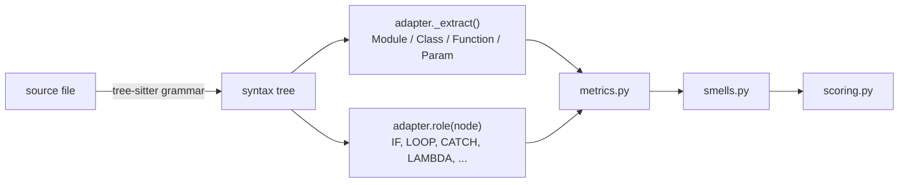

<a href="https://claude.ai"></a>

# aihealth

Code health estimates (1–10, CodeScene-style) for **Python**, **Dart/Flutter** and
**Makefiles**, built as feedback for AI coding agents.

- **delta**: did this change make the code healthier or worse? Verdict, score before → after,
  new/worsened smells with `path:line` and fix hints. Exit code 1 when health degraded.
- **scan**: overview of a codebase. Project score, worst files, top refactoring targets.
- **MCP server**: the same, as tools an agent calls itself.

Scores come from 13 explainable code smells: Brain Method, Large/Complex Method, Cognitive
Complexity, Deep Nesting, Bumpy Road, Excess Arguments, Complex Conditional, Deep Widget
Tree (Flutter), Large File, Low Cohesion, Primitive Obsession and Code Duplication. Bands:
healthy ≥ 9, warning 4–9, alert < 4.

## Install

```bash
python3 -m venv .venv && .venv/bin/pip install -e .     # or: make setup
```

## CLI

```bash
aihealth delta                      # working tree (incl. untracked) vs HEAD
aihealth delta --staged             # staged changes only
aihealth delta --base main --head HEAD lib/   # a commit range, limited to lib/
aihealth delta --format markdown    # agent-oriented output (also: text, json)

aihealth scan path/to/repo --format markdown --max-findings 20
aihealth scan . --fail-under 7      # CI gate on the project score
```

## History

```bash
aihealth scan . --save     # store in .aihealth/health.db (self-gitignored)
aihealth history           # score per saved scan, Δ, config changes
```

## Dashboard

```bash
aihealth serve --repo path/to/repo     # http://127.0.0.1:8765
```

It shows an overview (score, trend, where the penalty comes from, worst files), a treemap
(area = lines of code, colour = health), and per-file findings and function metrics. "Scan now"
runs and saves a scan. Charts load ECharts from a CDN.

## MCP server (Claude Code and other agents)

Register it for a project (run inside that project; the server analyses its working directory):

```bash
claude mcp add aihealth -- /path/to/ai-health/.venv/bin/aihealth mcp
```

Tools:

| Tool | Use |
|---|---|
| `review_changes` | Delta of uncommitted (or `staged`) changes vs `base`. Call after editing |
| `preview_change` | Score proposed `content` for a file against the current file without writing it |
| `score_file` | All smells in one file |
| `scan_project` | Project overview |
| `explain_smell` | What a smell measures and how to fix it |

All tools return markdown by default (`output: "json"` for machine use).

## Automatic feedback in Claude Code (hooks)

Instead of relying on the agent to remember, let Claude Code run aihealth itself. Add to the
project's `.claude/settings.json` (use the absolute path to your aihealth install):

```json
{
  "hooks": {
    "PostToolUse": [
      { "matcher": "Edit|Write",
        "hooks": [{ "type": "command", "command": "/path/to/ai-health/.venv/bin/aihealth hook post-edit" }] }
    ],
    "Stop": [
      { "hooks": [{ "type": "command", "command": "/path/to/ai-health/.venv/bin/aihealth hook stop" }] }
    ]
  }
}
```

- **post-edit**: after each edit of a Python/Dart file, checks that file against HEAD. Silent
  unless it got worse; then Claude gets the regressions with fix hints next to the edit result.
- **stop**: when Claude is about to finish, checks all uncommitted changes. If health degraded,
  Claude gets one more turn to fix them (or to say why they are intended). It never fires twice
  in a row, so it cannot loop.
- Both fail open: outside a git repo, for other languages, or on any error they do nothing.

## Makefiles

`Makefile`, `makefile`, `GNUmakefile` and `*.mk` files are scored with the same smells,
mapped onto make:

- **Rules with a recipe** are the "functions". The recipe is parsed as shell (bash), so long
  recipes (Large Method), nested `if`/`for` shell logic (Deep Nesting, Cognitive Complexity)
  and `&&`/`||` chains in conditions are measured on the real Makefile lines.
- **`define` blocks** are scored as canned shell recipes, or as make templates when they
  contain make syntax.
- **Top-level `ifeq`/`ifdef` blocks**, and variables built with `$(if)`, `$(or)`, `$(and)`
  or `$(foreach)`, are scored for their make-level branching.
- **Copied recipes** show up as Code Duplication. Fix hints suggest make remedies:
  pattern rules, `define` + `$(call)`, moving shell into a script file.

Generated files (automake, CMake, qmake output, and in every language anything marked
"DO NOT EDIT" or "@generated") are skipped.

## Configuration

Optional `.aihealth.toml` at the repository root (all keys in `src/aihealth/config.py`):

```toml
[thresholds]
large_method = 100

[weights]
primitive_obsession = 0          # 0 disables a smell

[scan]
exclude = ["legacy/*"]           # added to defaults (*.g.dart, *.freezed.dart, build/, ...)

[dart]
test_closure_calls = ["group", "test", "testWidgets", "patrolTest"]
```

Turn smells off for one file where they are imposed by an interface (e.g. CLI/JSON/MCP
boundaries) with a comment (strings and docstrings don't count):

```python
# aihealth: disable=primitive_obsession, excess_arguments
```

## Adding a language

All metrics, smells and scoring are language-neutral. A language is **one adapter file**
that tells the engine what the syntax tree means, plus tests that pin that meaning. Python
(`src/aihealth/lang/python.py`) and Dart (`lang/dart.py`) are the reference adapters. Copy
the one whose language is closer.

### How the pieces fit



The adapter answers two questions. **What are the functions, classes and parameters?**
That's `_extract`, which builds the model in `model.py`. **What does each node mean for
complexity?** That's the `roles` table plus a few hooks. Nothing else in the engine knows
about syntax.

### Steps

I'd do it in this order. Each step has a check before you move on.

1. **Spike the grammar first.** Grammars come from `tree-sitter-language-pack` (the name in
   `language` must match its grammar name). Write a fixture with *modern* syntax for the
   language, parse it, and dump the node types. Check that there are zero `ERROR` nodes,
   and note quirks: Dart, for example, puts a function body *next to* its signature
   instead of inside it. Add a test like `tests/test_parser_spike.py` that pins the node
   names you'll rely on, so a grammar upgrade fails loudly. Record the quirks in
   `cards/parser-choice.md`.

2. **Write the adapter** (`src/aihealth/lang/<name>.py`, subclass `LanguageAdapter`):

   | Part | What to provide |
   |---|---|
   | `language`, `extensions` | grammar name, file extensions |
   | `_extract(module)` | every scorable function as a `Function`: unique dotted `qualname`, `kind`, line span, `params`, and the **body node** (metrics walk only this). Classes, and their analogues (Go receiver types, Rust `impl` blocks, Swift extensions), become `Class`. Named nested functions become their own `Function` and are given the `STOP` role, so they aren't counted twice. |
   | `Param` | `named=True` for parameters that are named at the call site (Kotlin/Swift labels, Python keyword-only, Dart `{}`), which count half for Excess Arguments. `type_text` as written, or `None` if untyped. |
   | `roles` | node type → `Role`: `IF`, `LOOP`, `SWITCH`, `CASE` (non-default arms), `CATCH`, `TERNARY`, `LAMBDA` (closures), `STOP`, `COMPREHENSION`, `JUMP_LABEL`, `BOOL_EXPR` |
   | `role(node)` override | only where meaning depends on context: an else-if, a `default`/`_` arm, a catch body that is a sibling block, labeled jumps |
   | `bool_token(node)` | `"and"`/`"or"` for `&&`/`\|\|`/`and`/`or` tokens. Count tokens, don't trust the tree shape (grammars disagree on precedence). |
   | `comment_types`, `block_types`, `bool_transparent` | for line counts, statement lists and condition detection |
   | `primitive_types`, `base_types()` | for Primitive Obsession; generics are judged by their type arguments (`List<Order>` is a domain type) |
   | `literal_types` | literal nodes that duplication detection normalises |
   | `member_refs(cls)` | which fields/methods each method touches (LCOM4 cohesion). It can return `{}` at first, which simply disables the smell. |
   | `widget_depth(body)` | optional UI-tree depth. It suits JSX, SwiftUI and Compose as well as Flutter. |

3. **Register it**: add the class to `ADAPTERS` in `src/aihealth/lang/__init__.py`. Add
   generated-file patterns to `DEFAULT_EXCLUDES` in `config.py`. If the language needs
   options (like Dart's `test_closure_calls`), add a config section and map it in
   `Config.adapter_options`.

4. **Golden metric tests.** Port the SonarSource cognitive-complexity examples
   (`sumOfPrimes` = 7, `getWords` = 1, `a && b && c || d || e && f` = +3), as in
   `tests/test_metrics.py`. Then add cases for the language's own constructs: else-if,
   default arms, closures, labeled breaks, pattern matching, error handling.

5. **Coverage check on real code.** Run the adapter over a large, well-known codebase in the
   language. There should be no crashes, every function-body node should be extracted, and
   it should be reasonably fast (Dart reached 100 % of 60,461 bodies across the Flutter SDK).
   Fix what's missed. The misses are usually unusual declaration forms.

6. **Calibrate.** Add a few well-regarded libraries and a few big, complex codebases to
   `CORPORA` in `scripts/calibrate.py`, then run it. Good libraries should land mostly
   *healthy* and complex code around 5–7. If a language idiom trips a threshold everywhere
   (as Flutter `build()` methods did for Large Method), add a targeted, measured exception
   rather than a global change, and record the numbers in `cards/code-health-model.md`.

7. **Dogfood and document.** Run `aihealth delta` on the adapter itself. Update this README
   and the language list at the top.

### Things to decide per language

- **What counts as a function**: arrow functions assigned to a name
  (`const f = () => {}` in TS/JS) should be scored as named functions, while inline
  callbacks stay part of their parent. Test-framework closures (`describe`/`it`, XCTest)
  likely deserve the Dart treatment, so a test file isn't one giant function.
- **Idiomatic branching**: Go's `if err != nil { return err }` adds a branch to every call.
  Check in calibration whether it should get the same exemption as asserts.
- **Named arguments**: Kotlin, Swift and C# have them, and they should count half,
  consistent with Dart and Python.
- **UI trees**: JSX, SwiftUI `body` and Compose `@Composable` functions map onto
  `widget_depth` and the Deep Widget Tree smell.

## License

MIT, see [LICENSE](LICENSE).
