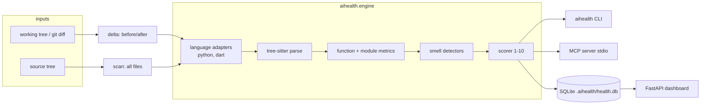

# architecture

How the aihealth engine, CLI, MCP server, storage and dashboard fit together.

## Components

Planned package layout (`src/aihealth/`):

| Module | Owns |
|---|---|
| `lang/` | One adapter per language. Maps tree-sitter node types to a uniform model: `Module`, `Class`, `Function` (name, span, params with type hints, body node). Decision-point node types and nesting node types live here. |
| `metrics.py` | Language-neutral metric computation over the uniform model: LoC, cyclomatic, cognitive complexity, max nesting, bumpy-road bumps, argument count, complex conditionals, widget-tree depth (Dart only, adapter-provided). |
| `duplication.py` | Token-based clone detection across functions in a file and across files in a scan. |
| `smells.py` | Thresholds → smell findings (`Finding(path, function, smell, severity, line, detail, hint)`). |
| `scoring.py` | Penalties → file score, LoC-weighted project score, bands. |
| `config.py` | Defaults + `.aihealth.toml` overrides (thresholds, weights, excludes). |
| `delta.py` | Resolves before/after content via git (`git show <rev>:<path>`, index, working tree), pairs functions by qualified name, classifies smells as new / worsened / fixed. |
| `report.py` | Renders results as text, json, or agent-oriented markdown. |
| `cli.py` | `aihealth scan`, `aihealth delta`, `aihealth serve`, `aihealth mcp`. |
| `mcp_server.py` | FastMCP stdio server wrapping the engine. |
| `store/` | SQLite connection, `MIGRATIONS` list, `PRAGMA user_version` runner, scan persistence. |
| `web/` | FastAPI app, Jinja templates, static assets; reads only from the store. |

## Data flow

- **Scan:** walk files (respect `.gitignore` + config excludes) → adapter by
  extension (`.py`, `.dart`) → metrics → smells → file score → project
  score. Optionally persisted as one `scan` row with `file_score` and
  `finding` rows.
- **Delta:** for each changed file of a supported language, score the
  *before* and *after* content independently, then diff findings per
  function. Deleted files are ignored; new files are scored with an empty
  baseline. Verdict: `improved`, `unchanged`, `degraded`; exit code 1 on
  `degraded` so agents and CI can gate on it.
- **MCP:** the server holds no state; each tool call runs the engine on the
  repo path given (default: cwd) and returns compact JSON with hints.
- **Dashboard:** `aihealth serve --repo PATH` opens the repo's DB, runs a scan
  on request, and renders overview, treemap, file detail and trend pages.

## Agent feedback contract

The agent-facing output (MCP and `--format markdown`) is short by design:
verdict, score before → after per touched file, and at most N findings
ranked by penalty, each with function name, line, the metric value vs.
threshold, and a one-line refactoring hint ("extract the nested loop at
L42 into a helper"). Full detail is available via `--format json`.

## Deployment shape

Local developer tool. Installed into a venv (`pip install -e .`), run as a
CLI, as an MCP server launched by the agent host over stdio, or as a local
web server on `127.0.0.1`. No network services, no auth.
