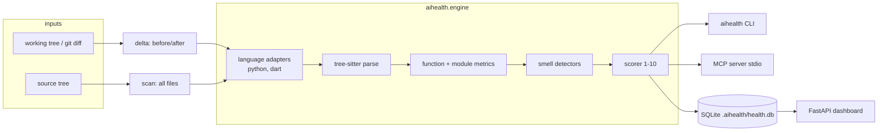

# architecture

How the aihealth engine, CLI, MCP server, storage and dashboard fit together.

## Components

Planned package layout (`src/aihealth/`):

| Module | Owns |
|---|---|
| `model.py` | The uniform model: `Module` (path, language, source, tree root, loc, error_count), `Class` (name, kind: class/mixin/extension/enum), `Function` (name, qualname, kind: function/method/constructor/getter/setter/operator, 1-based line span, `Param`s, body node, loc). `Module.all_functions()` lists every scorable function. |
| `lang/` | One adapter per language (`python.py`, `dart.py`) subclassing `LanguageAdapter` in `base.py`, plus a registry (`adapter_for(path)`, `parse_file`, `parse_source`). Adapters build the model. LoC counting (code lines only, excluding comments and docstrings) is shared in `base.py`. Nested named functions are separate `Function`s with dotted qualnames (`outer.inner`); closures and lambdas stay inside their parent. M3 adds decision-point and nesting node-type sets here. |
| `metrics.py` | `function_metrics(fn, adapter) -> FunctionMetrics`: cyclomatic, cognitive, max nesting (and the line it occurs on), bumps, boolean expressions with operator counts, args/named args, and widget depth. A single iterative walk with no recursion limit. Language knowledge comes only from the adapter: `role(node)` maps nodes to a `Role` (IF, LOOP, SWITCH, CASE, CATCH, TERNARY, LAMBDA, STOP, COMPREHENSION, JUMP_LABEL, BOOL_EXPR), plus the hooks `bool_token`, `is_recursive_call`, `statements`, `unwrap_loop` and `widget_depth`. Adding a language means filling the role table and overriding hooks only where roles depend on context. |
| `duplication.py` | `DuplicationIndex`: `add(module, adapter)` for each module, then `clones()`. Token streams per function (literals normalised via the adapter's `literal_types`), winnowed rolling hashes, and matches extended to full length. Works within a file and across files. |
| `smells.py` | `detect(module, adapter, config, metrics, clones) -> [Finding]`. A `Finding` has smell, level (function/class/file), path, line, symbol, value, threshold, severity, message, hint, weight, share and penalty. `HINTS` and `LABELS` live here. Also `lcom4()`. Class and file smells use the adapter hooks `member_refs`, `is_primitive` / `base_types` and `primitive_types`. |
| `scoring.py` | `penalty`, `file_score` (exponential decay 10 → 1), `band`, `project_score` (LoC-weighted), `FileScore` (with `to_dict`). |
| `config.py` | `load_config(repo, path) -> Config`: built-in defaults deep-merged with `.aihealth.toml`. Unknown keys raise `ConfigError`. Sections: thresholds, weights, scan (exclude, use_default_excludes, max_file_kb), score.decay, primitive_obsession, duplication, delta, dart.test_closure_calls. `config.adapter_options(lang)` feeds adapter constructors, and the registry caches adapters per option set. |
| `engine.py` | The facade every interface uses. `score_source(bytes, path, config)` scores a single file (duplication within the file only). `scan(root, config) -> ScanResult` discovers files with `git ls-files` (falling back to `os.walk`), applies excludes (fnmatch, `*` crosses `/`, matched against every path suffix), and runs cross-file duplication. |
| `gitutil.py` | Subprocess git plumbing. `repo_root`, `has_revision`. `Revisions(base, head)`: base None means an empty repository, and head is `WORKTREE` (files on disk plus untracked), `INDEX` or a revision. `changed_files(root, revs, paths)` uses `diff --name-status -M` for renames, plus untracked files for the worktree. `read_file(root, rev, path)`. |
| `delta.py` | `run_delta(repo, config, revs, paths) -> DeltaResult`. For each changed supported, non-excluded file, `delta_for_contents(change, before, after, config)` scores both versions with `engine.score_source`, `compare()` pairs findings by (level, symbol, smell), and `file_verdict()` applies the rules. `FileDelta` and `DeltaResult` have `to_dict()` for JSON/MCP. |
| `report.py` | `render_scan(result, fmt, ReportOptions)` / `render_delta(...)` return strings for `fmt` in `FORMATS` (text, markdown, json). `ReportOptions(top, max_findings, verbose, functions)`. The CLI only prints these, and MCP (M7) should return the markdown or json from here too. |
| `cli.py` | `aihealth scan [--save] [--db]`, `aihealth delta`, `aihealth history`, `aihealth mcp`, `aihealth serve`. |
| `hooks.py` | Claude Code hooks (`aihealth hook post-edit|stop`, JSON on stdin). post-edit runs delta for `tool_input.file_path` only and, if DEGRADED, returns PostToolUse `hookSpecificOutput.additionalContext` (markdown, max 5 places). stop runs delta for all uncommitted changes and, if DEGRADED, returns Stop `additionalContext` with a preamble that lets Claude finish when a regression is intended. It returns nothing when `stop_hook_active` is set (Claude Code also caps continuations at 8). `run()` never raises: any error means empty output and exit 0. In this repo they are wired through `.claude/hooks/post-edit.sh` (format, then health, in one script so they don't race) and `.claude/hooks/stop.sh`. |
| `mcp_server.py` | MCP stdio server (mcp SDK 2.x `MCPServer`, pinned `>=2,<3`; v2 renamed FastMCP). The tools are plain functions: `review_changes`, `score_file`, `preview_change` (score proposed content vs the current file without writing it), `scan_project` and `explain_smell`. They return `report.render_*` markdown or json. Input problems raise `ToolInputError`, which `build_server` converts to the SDK's `ToolError`: v2 hides the message of any other exception. Registered with `structured_output=False`, because otherwise the text is sent twice. `.mcp.json` registers it for this repo. |
| `store/` | `migrations.py`: forward-only `MIGRATIONS` list; `migrate(conn)` runs each pending step in `BEGIN…COMMIT` together with `PRAGMA user_version = N`, and raises `SchemaTooNewError` if the database is newer than the code. v1 is scan/file_score/finding, v2 is function_metric. `scans.py`: `connect(path)` creates the directory (writing a `.aihealth/.gitignore` containing `*`), sets foreign keys on and migrates. Also `save_scan(conn, result, config, git)` in one transaction (git commit/branch/dirty, tool version, `config_hash`), and the queries `list_scans`, `get_scan`, `get_file`, `project_trend`, `file_trend`, `latest_scan_id`. Default DB: `<repo>/.aihealth/health.db`. |
| `web/` | `app.py`: `create_app(repo, db)` (FastAPI). The pages are `/` (overview: stat tiles, score trend, penalty-by-smell bars, worst files), `/treemap` (area = LoC, colour = band) and `/file?path=` (findings, function metrics against the *configured* limits, file trend). `POST /scan` runs a scan and saves it. There is a JSON API under `/api/`. A new SQLite connection is opened per request through an `Annotated[..., Depends]` alias. The module has no `from __future__ import annotations`, because FastAPI must resolve that closure-local alias. `views.py` does the data shaping (no framework imports) and `templates/` uses Jinja2 with a `badge` macro (icon + label + status colour). `static/charts.js` draws ECharts 5.5.1 from the jsdelivr CDN, coloured from CSS tokens, and re-renders on OS scheme or `data-theme` changes. `aihealth serve` binds 127.0.0.1:8765. |

## Data flow

- **Scan:** walk files (respect `.gitignore` + config excludes) → adapter by
  extension (`.py`, `.dart`) → metrics → smells → file score → project
  score. Optionally persisted as one `scan` row with `file_score` and
  `finding` rows.
- **Delta:** for each changed file of a supported language, score the
  *before* and *after* content independently, then diff findings per
  function. Deleted files are ignored; new files are scored with an empty
  baseline. Verdict: `improved`, `unchanged`, `degraded`; exit code 1 on
  `degraded` so agents and CI can gate on it.
- **MCP:** the server holds no state; each tool call runs the engine on the
  repo path given (default: cwd) and returns compact JSON with hints.
- **Dashboard:** `aihealth serve --repo PATH` opens the repo's DB, runs a scan
  on request, and renders overview, treemap, file detail and trend pages.

## Agent feedback contract

The agent-facing output (`--format markdown`, and MCP from M7) is short by
design:

- **delta:** a heading naming what was compared; a one-line verdict
  (`**DEGRADED**: … Fix the issues below before finishing.`); a table of
  files with before/after/Δ/verdict; a syntax-error warning if any file
  parsed partially; "Fix before finishing"; and "Improvements".
- **scan:** the project score and band counts, a "Worst files" table, and
  "Top refactoring targets".
- Entries are **grouped per (file, symbol)**, ranked by total penalty, and
  capped at `--max-findings` (default 10, with a "…and N more" line). Each
  entry is `N. **path:line** \`symbol\`: Smell (new), Smell (worse, was 4)`
  followed by one bullet per message and up to 3 distinct `Fix:` hints.
  `path:line` is the first finding's line, so it can be opened directly.
- Full detail is available via `--format json`.

## Deployment shape

Local developer tool. Installed into a venv (`pip install -e .`), run as a
CLI, as an MCP server launched by the agent host over stdio, or as a local
web server on `127.0.0.1`. No network services, no auth.
